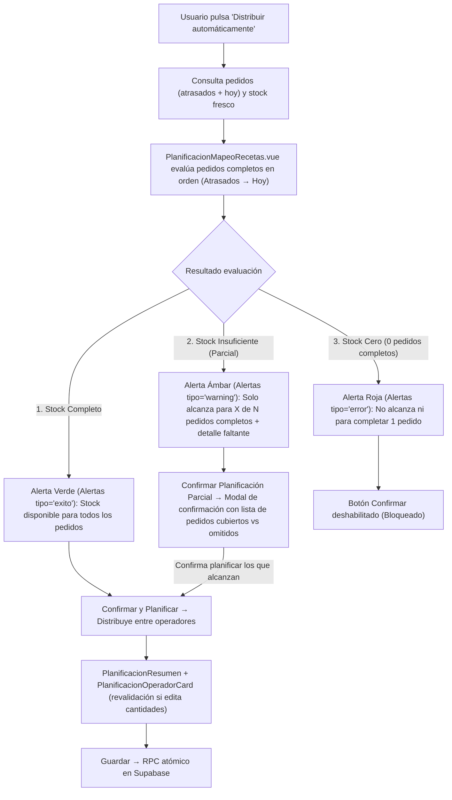

# Plan de Implementación: Planificación por Pedidos Completos Sujeta a Stock Real

## Goal Description

Actualmente, el módulo de planificación de `mms_app` opera estrictamente bajo demanda (*Make-to-Order*): agrupa los pedidos pendientes y atrasados por categoría, exige mapear recetas por el 100% de los tallos solicitados y distribuye la carga entre operadores sin consultar el stock en `materia_prima` ni en `materiales`.

Este plan define la implementación para **restringir y ajustar la planificación según la disponibilidad real de inventario**, bajo la regla de negocio acordada:
- **Planificar únicamente pedidos completos que alcancen con el stock actual** (sin dividir un pedido entre dos días), evaluados en orden estricto de prioridad: **primero pedidos atrasados (`fecha_pedido < fecha`), luego pedidos pendientes del día (`fecha_pedido = fecha`)**.
- Descontar y considerar **materiales y materia prima compartidos** entre múltiples recetas y pedidos mediante una bolsa virtual en memoria (Frontend) y bloqueo transaccional en PostgreSQL (Backend).
- Informar al usuario mediante alertas en UI para los tres escenarios:
  1. **Stock Completo (Suficiente)**: El stock cubre el 100% de los pedidos pendientes (`atrasados` + `del día`).
  2. **Stock Insuficiente (Planificación Parcial por pedidos completos)**: No alcanza para todos los pedidos, pero sí para completar uno o más pedidos enteros. Se alerta indicando cuántos pedidos completos se planificarán (priorizando atrasados), cuáles quedan pendientes/atrasados y qué insumos limitan el resto.
  3. **Stock Cero (Sin alcance)**: El stock no alcanza para completar **ni un solo pedido entero**. Se alerta del déficit crítico y se bloquea la confirmación.

---

## Diagnóstico del Flujo Actual (Backend y Frontend)

### 1. Arquitectura General
La aplicación es una SPA en **Vue 3 + Vite** conectada directamente a **Supabase (PostgreSQL + RPCs + RLS)** mediante `src/client/*.js`. Toda la lógica de servidor reside en funciones RPC de PostgreSQL (`db/02_rpc_functions.sql`).

### 2. Brechas Detectadas en el Flujo Actual
1. **Sin consulta de stock en planificación (`PlanificacionAlgoritmo.js` / `usePlanificacion.js`)**:
   - `distribuirAutomaticamenteBase()` solo consulta `pedidos` pendientes y `PlanificacionMapeoRecetas.vue` obliga a asignar el 100% de `cat.totalStems`.
2. **Orden entre categorías vs. pedidos atrasados (`PlanificacionAlgoritmo.js`)**:
   - `_obtenerPedidosPendientes(fecha)` consulta `.lte('fecha_pedido', fecha).eq('estado', 'Pendiente').order('fecha_pedido', { ascending: true })`, pero `obtenerPedidosAgrupadosPorCategoria` reordena las categorías por volumen (`b.totalStems - a.totalStems`).
   - Además, `crearPlanificacionesMasivas` (líneas 278 y 425) filtra con `.eq('fecha_pedido', fecha)` en lugar de `.lte('fecha_pedido', fecha)`, omitiendo pedidos atrasados al actualizar `operador_id` y `pedido_detalles`.
3. **Orden invertido al autocompletar pedidos (`src/client/DashboardClient.js`)**:
   - `_queryPedidos(fecha)` ordena por `.order('fecha_creacion', { ascending: false })` (los pedidos **más nuevos primero**). Si hoy solo se produjeron los tallos para cubrir pedidos atrasados, `autoCompletarPedidos` podría completar primero pedidos del día de menor o igual tamaño y dejar sin completar los atrasados.
4. **Guardado no atómico (`PlanificacionAlgoritmo.crearPlanificacionesMasivas` / `PlanificacionClient.js`)**:
   - Ejecuta múltiples escrituras independientes sin transacción ni validación de stock en servidor, y sobrescribe `pedido_detalles` asumiendo cobertura del 100%.

---

## Decisiones Confirmadas

> [!NOTE]
> **1. Equivalencia 1:1 de consumo (`stems` / cantidad planificada):**
> Cada unidad planificada en `planificacion_recetas.cantidad` consume exactamente `rmp.cantidad` de `materia_prima` y `rm.cantidad` de `materiales` (idéntico a `rpc_obtener_kpis_dashboard` y `rpc_registrar_produccion`).

> [!IMPORTANT]
> **2. Planificación por pedidos completos (cero pedidos partidos entre 2 días):**
> Al evaluar el stock por **pedido completo** (verificando que alcancen los insumos para **todas** las líneas/categorías de ese pedido antes de incluirlo):
> - Ningún pedido queda partido a medias entre dos jornadas.
> - Se preserva intacto `pedido_detalles.stems`.
> - Los pedidos incluidos se completarán al 100% en `DashboardClient.autoCompletarPedidos(fecha)` al finalizar su producción; los que no alcanzaron quedan intactos en `'Pendiente'` (y al día siguiente figurarán como `'Atrasado'` con máxima prioridad).

> [!WARNING]
> **3. Prioridad estricta en planificación y autocompletado:**
> Tanto el algoritmo de asignación de stock compartido (`planificacionStock.js` / `PlanificacionAlgoritmo.js`) como `DashboardClient.autoCompletarPedidos(fecha)` deben procesar los pedidos en orden `fecha_pedido ASC, fecha_creacion ASC` (primero atrasados, del más antiguo al más reciente; luego pendientes del día).

---

## Proposed Changes

### 1. Motor de Cálculo de Alcance por Pedidos Completos (Frontend)

#### [NEW] [src/utils/planificacionStock.js](file:///c:/Users/jtony/OneDrive/Escritorio/TESIS%20APP/mms_app/src/utils/planificacionStock.js)
Módulo puro encargado de evaluar qué pedidos completos alcanzan con el stock actual considerando insumos compartidos.

- **Entradas**:
  - `pedidosOrdenados`: lista de pedidos pendientes ordenada por `fecha_pedido ASC, fecha_creacion ASC` (`esAtrasado = fecha_pedido < fechaSeleccionada`), cada uno con sus detalles `{ categoria, stems, recetaOriginalId }`.
  - `mapeoCategorias`: `{ [categoria]: [{ recetaId, stems }] }` definido en el asistente.
  - `recetasMap`: mapa `recetaId -> receta` (con `materiaPrima[]` y `materiales[]`).
  - `materiaPrimaLista` y `materialesLista`: inventario fresco actual.
- **Algoritmo (Evaluación por Pedido Completo sobre Bolsa Virtual Compartida)**:
  1. Inicializar `restanteMP` y `restanteMat` con el stock disponible actual (`cantidad_total` / `cantidad`).
  2. Inicializar `capacidadRestanteMapeo` por categoría/receta según la distribución proporcional o secuencial definida en `mapeoCategorias`.
  3. Recorrer `pedidosOrdenados` (atrasados más antiguos primero, luego pendientes del día):
     - Para un pedido completo $P$, determinar las recetas asignadas a sus detalles y calcular el consumo total requerido de `materia_prima` y `materiales` del pedido $P$ completo (sumando si dos líneas del mismo pedido comparten un mismo insumo).
     - Verificar si `restanteMP[id] >= reqMP_pedido[id]` para todas las MP del pedido **y** `restanteMat[id] >= reqMat_pedido[id]` para todos los materiales del pedido.
     - **Si alcanza para el pedido completo $P$**:
       - Descontar el consumo del pedido $P$ de `restanteMP` y `restanteMat` (actualizando la bolsa virtual para el siguiente pedido).
       - Agregar $P$ a `pedidosPlanificables[]` y acumular sus stems en `stemsPlanificablesPorReceta`.
     - **Si NO alcanza para el pedido completo $P$**:
       - Agregar $P$ a `pedidosOmitidos[]` junto con sus insumos faltantes (déficit respecto al `restante` actual, sin descontar de la bolsa virtual).
       - Continuar evaluando el siguiente pedido (así un pedido pequeño posterior que sí quepa completo puede aprovechar el stock remanente sin partir ningún pedido; configurable si se requiere freno estricto FIFO).
  4. Clasificar el **estado global** para las alertas en UI:
     - **`'completo'`**: `pedidosPlanificables.length === pedidosOrdenados.length` y `pedidosOrdenados.length > 0`.
     - **`'parcial'`**: `0 < pedidosPlanificables.length < pedidosOrdenados.length`.
     - **`'cero'`**: `pedidosPlanificables.length === 0` (el stock no alcanza para completar ningún pedido).
  5. Retornar `{ estadoGlobal, pedidosPlanificables, pedidosOmitidos, stemsPorCategoria, mapeoAjustado, resumenFaltantes, totalPedidos, totalStemsSolicitados, totalStemsPlanificables, atrasadosCubiertos, atrasadosOmitidos }`.

#### [MODIFY] [src/client/PlanificacionAlgoritmo.js](file:///c:/Users/jtony/OneDrive/Escritorio/TESIS%20APP/mms_app/src/client/PlanificacionAlgoritmo.js)
- **En `_obtenerPedidosPendientes(fecha)`**:
  - Incluir `fecha_creacion` en el `.select(...)` y ordenar `.order('fecha_pedido', { ascending: true }).order('fecha_creacion', { ascending: true })` para desempate determinístico en pedidos del mismo día.
- **En `obtenerPedidosAgrupadosPorCategoria(fecha)`**:
  - Retornar, además de `categorias` (ordenadas priorizando categorías con `esAtrasado` primero y luego `totalStems`), la lista plana `pedidosOrdenados` (ordenada `fecha_pedido ASC, fecha_creacion ASC`) con `esAtrasado: pedido.fecha_pedido < fecha` para alimentar directamente al evaluador de pedidos completos.
- **En `asignarYDistribuir(pedidosPlanificables, mapeoAjustado, todasLasRecetas, operadoresActivos)`**:
  - Construir `gruposReceta` **únicamente** a partir de `pedidosPlanificables` y `mapeoAjustado` (excluyendo recetas/categorías que quedaron en `0` stems).
  - Eliminar el desbordamiento de `remainingStems` hacia `lastRecipe` (líneas 144-154), garantizando que los `pedidosAsignados` en las tarjetas de operadores coincidan exactamente con los pedidos completos planificados.
- **En `crearPlanificacionesMasivas(distribuciones, fecha, pedidosPlanificablesIds, mapeoCategorias)`**:
  - Corregir el filtro de pedidos de `.eq('fecha_pedido', fecha)` a `.lte('fecha_pedido', fecha)` y restringir la actualización de `operador_id` y remapeo de receta **únicamente a `pedidosPlanificablesIds`** (sin recortar `pedido_detalles.stems` ni tocar los pedidos que quedaron fuera por falta de stock).
  - Delegar la persistencia atómica al nuevo método `PlanificacionClient.crearPlanificacionesConStock(...)`.

---

### 2. Corrección de Prioridad en Autocompletado y Capa de Clientes

#### [MODIFY] [src/client/DashboardClient.js](file:///c:/Users/jtony/OneDrive/Escritorio/TESIS%20APP/mms_app/src/client/DashboardClient.js)
- En `autoCompletarPedidos(fecha)` (línea 105):
  - Antes de evaluar qué pedidos pendientes quedan cubiertos por la producción del día, ordenar `pedidosPendientes` explícitamente por `fecha_pedido ASC` (atrasados primero) y luego `fecha_creacion ASC` (en lugar de heredar `.order('fecha_creacion', { ascending: false })` de `_queryPedidos`).
  - Así se garantiza que la producción registrada cierre primero los pedidos atrasados y luego los pendientes del día que sí fueron planificados, dejando intactos en `'Pendiente'` los que no alcanzaron por stock.

#### [MODIFY] [src/client/PlanificacionClient.js](file:///c:/Users/jtony/OneDrive/Escritorio/TESIS%20APP/mms_app/src/client/PlanificacionClient.js)
- Agregar `crearPlanificacionesConStock({ fecha, distribuciones, pedidosIds, mapeoRecetasPorPedido })` que invoque al RPC `rpc_crear_planificacion_con_stock` y traduzca códigos de error (`STOCK_INSUFICIENTE`, `PLANIFICACION_DUPLICADA`) a respuestas estructuradas `{ success: false, code, details, error }`.

#### [MODIFY] [src/composables/usePlanificacion.js](file:///c:/Users/jtony/OneDrive/Escritorio/TESIS%20APP/mms_app/src/composables/usePlanificacion.js)
- Almacenar `pedidosOrdenados`, `materiaPrimaStock`, `materialesStock` y `evaluacionStock`.
- En `distribuirAutomaticamenteBase()`:
  - Cargar en paralelo los pedidos (`obtenerPedidosAgrupadosPorCategoria`) y el inventario fresco (`catalogos.obtenerMateriaPrima(true)` y `catalogos.obtenerMateriales(true)`).
- En `confirmarMapeoYPlanificarBase(mapeo, evaluacion)`:
  - Usar `evaluacion.pedidosPlanificables` y `evaluacion.mapeoAjustado` para ejecutar `PlanificacionAlgoritmo.asignarYDistribuir(...)`.
  - Disparar las alertas globales correspondientes:
    - `completo` → `'exito'` (*"Stock suficiente: todos los X pedidos (Y stems) cuentan con inventario completo."*).
    - `parcial` → `'warning'` persistente (`duracion = 0`) (*"Stock insuficiente: se planificaron X de N pedidos completos (Y de Z stems), priorizando atrasados. Quedan K pedidos pendientes por falta de ..."*).
    - `cero` → `'error'` persistente (`duracion = 0`), impidiendo generar asignaciones.
- Agregar `revalidarStockAsignaciones()`:
  - Antes de guardar en `guardarTodasBase()`, refrescar stock (`forceRefresh = true`) y validar que la suma de recetas editadas manualmente en `PlanificacionOperadorCard.vue` siga siendo cubierta por el stock disponible real.

---

### 3. Interfaz de Usuario y Flujo de Alertas (Frontend)

#### [NEW] [src/components/planificacion/PlanificacionStockModal.vue](file:///c:/Users/jtony/OneDrive/Escritorio/TESIS%20APP/mms_app/src/components/planificacion/PlanificacionStockModal.vue)
Modal de confirmación previa cuando `estadoGlobal === 'parcial'`:
- Muestra el resumen: **Pedidos a planificar** (indicando cuántos son atrasados y cuántos de hoy) vs. **Pedidos que quedarán pendientes** por falta de stock.
- Lista los insumos limitantes (disponible actual, requerido para los pedidos faltantes y déficit).
- Botones: `Volver al mapeo` y `Planificar X pedidos completos (Y stems)`.

#### [MODIFY] [src/components/planificacion/PlanificacionMapeoRecetas.vue](file:///c:/Users/jtony/OneDrive/Escritorio/TESIS%20APP/mms_app/src/components/planificacion/PlanificacionMapeoRecetas.vue)
- Recibir props `pedidosOrdenados`, `materiaPrimaStock`, `materialesStock`.
- Calcular en `computed` el resultado en vivo de `evaluarPedidosCompletosPorStock(...)` cada vez que cambie la selección de recetas o proporciones.
- Renderizar `<Alertas>` en la parte superior del wizard con los 3 estados:
  1. `exito` (Stock Completo).
  2. `warning` (Stock Insuficiente — planificará solo pedidos completos que alcancen, mostrando insumos faltantes y pedidos omitidos).
  3. `error` (Stock Cero — no alcanza ni para 1 pedido completo).
- Mostrar por cada tarjeta de categoría un badge indicando cuántos stems/pedidos de esa categoría alcanzan (`Ej: 2 de 3 pedidos cubiertos — 120 / 200 stems`).
- En `formularioValido`: permitir continuar si `estadoGlobal === 'completo'` o `'parcial'` (`pedidosPlanificables.length > 0`), y bloquear el botón si `estadoGlobal === 'cero'`.

#### [MODIFY] [src/components/planificacion/PlanificacionResumen.vue](file:///c:/Users/jtony/OneDrive/Escritorio/TESIS%20APP/mms_app/src/components/planificacion/PlanificacionResumen.vue)
- Mostrar estado de validación de stock ante ediciones manuales en `PlanificacionOperadorCard.vue`: si el supervisor incrementa manualmente cantidades y supera el stock disponible, mostrar alerta `error` en `mensajeInline` y deshabilitar **"Guardar todas las planificaciones"** hasta ajustar.
- Si es una planificación parcial, mostrar una alerta informativa recordando los pedidos que quedaron fuera esperando reabastecimiento.

#### [MODIFY] [src/pages/PlanificacionPage.vue](file:///c:/Users/jtony/OneDrive/Escritorio/TESIS%20APP/mms_app/src/pages/PlanificacionPage.vue)
- Conectar `pedidosOrdenados`, `materiaPrimaStock`, `materialesStock` y `evaluacionStock` con `PlanificacionMapeoRecetas.vue`, `PlanificacionResumen.vue` y `PlanificacionStockModal.vue`.

---

### 4. Base de Datos / Backend (Supabase PostgreSQL)

#### [MODIFY] [db/02_rpc_functions.sql](file:///c:/Users/jtony/OneDrive/Escritorio/TESIS%20APP/mms_app/db/02_rpc_functions.sql)
Crear `public.rpc_crear_planificacion_con_stock(p_fecha date, p_distribuciones jsonb, p_pedidos_ids text[], p_mapeo_recetas jsonb)`:
1. Validar rol `public.obtener_usuarios_rol() = 'supervisor'` con `SET search_path = public, pg_temp`.
2. Calcular el requerimiento total agregado por `materia_prima_id` y `material_id` de todas las recetas/cantidades en `p_distribuciones`.
3. Bloquear en orden ascendente por `id` las filas afectadas en `materia_prima` y `materiales` con `FOR UPDATE` para prevenir condiciones de carrera.
4. Verificar `stock_actual >= requerido` para cada insumo. Si falla alguno, abortar transacción lanzando excepción/JSON estructurado con el insumo y déficit (`STOCK_INSUFICIENTE`).
5. Insertar en `planificaciones` y `planificacion_recetas`, actualizar `pedidos.operador_id` únicamente para `p_pedidos_ids` (los pedidos completos incluidos), y actualizar `receta_id` de `pedido_detalles` solo de esos pedidos sin alterar su `stems`.

---

## Orden Recomendado de Implementación

1. **`src/utils/planificacionStock.js`**: Motor puro de evaluación por pedidos completos con prioridad `atrasados → pendientes del día` y bolsa virtual compartida.
2. **`src/client/PlanificacionAlgoritmo.js` y `src/client/DashboardClient.js`**: Adaptar `obtenerPedidosAgrupadosPorCategoria`, `asignarYDistribuir` y `crearPlanificacionesMasivas` (corrigiendo `.lte('fecha_pedido', fecha)`), y corregir el orden `fecha_pedido ASC` en `autoCompletarPedidos`.
3. **`db/02_rpc_functions.sql` y `src/client/PlanificacionClient.js`**: Implementar y registrar `rpc_crear_planificacion_con_stock` con bloqueo `FOR UPDATE`.
4. **`src/composables/usePlanificacion.js`**: Integrar carga de stock fresco (`forceRefresh = true`), evaluación de stock y revalidación al guardar.
5. **Componentes UI (`PlanificacionMapeoRecetas.vue`, `PlanificacionStockModal.vue`, `PlanificacionResumen.vue`, `PlanificacionPage.vue`)**: Alertas visuales de los 3 estados, modal de confirmación parcial y bloqueo ante stock cero o exceso manual.

---

## Verification Plan

### Automated Checks
Una vez aprobado e implementado:
1. `npm run build` para verificar compilación limpia de Vite/Vue.
2. Pruebas unitarias sobre `planificacionStock.js` cubriendo:
   - **Stock Completo**: 100% de pedidos atrasados y del día cubiertos.
   - **Stock Insuficiente (Prioridad Atrasados + Pedidos Completos)**: 1 pedido atrasado (60 stems) + 1 pedido de hoy (80 stems) con stock para 90 stems → planifica únicamente el pedido atrasado completo (60 stems), omite el de 80 sin partirlo en 2 días.
   - **Material Compartido**: Pedido A (atrasado, Receta 1) y Pedido B (hoy, Receta 2) comparten `Ligas`; verifica descuento en bolsa virtual antes de evaluar Pedido B.
   - **Pedido Multi-Categoría**: Pedido con 2 categorías donde solo alcanza stock para 1 categoría → el pedido completo se omite para no partirlo.
   - **Stock Cero**: Stock menor al pedido completo más pequeño/prioritario → `estadoGlobal: 'cero'`.
3. Validación SQL en Supabase (`get_advisors` y pruebas transaccionales con `execute_sql`) para confirmar `search_path`, permisos de supervisor y rechazo atómico si el stock cambia antes de guardar.

### Manual Verification
1. Probar flujo completo con stock suficiente → verificar alerta verde (`exito`), distribución y guardado.
2. Probar con stock parcial teniendo pedidos atrasados y pedidos de hoy → verificar alerta ámbar (`warning`), modal confirmando que se planifican solo los pedidos completos priorizando atrasados, y verificar tras registrar producción que `DashboardClient.autoCompletarPedidos` completa primero los atrasados y deja pendientes los omitidos.
3. Probar con stock insuficiente para completar siquiera 1 pedido → verificar alerta roja (`error`) y bloqueo del botón de confirmación.
4. Probar edición manual en `PlanificacionOperadorCard.vue` excediendo stock → verificar bloqueo y alerta en `PlanificacionResumen.vue`.
